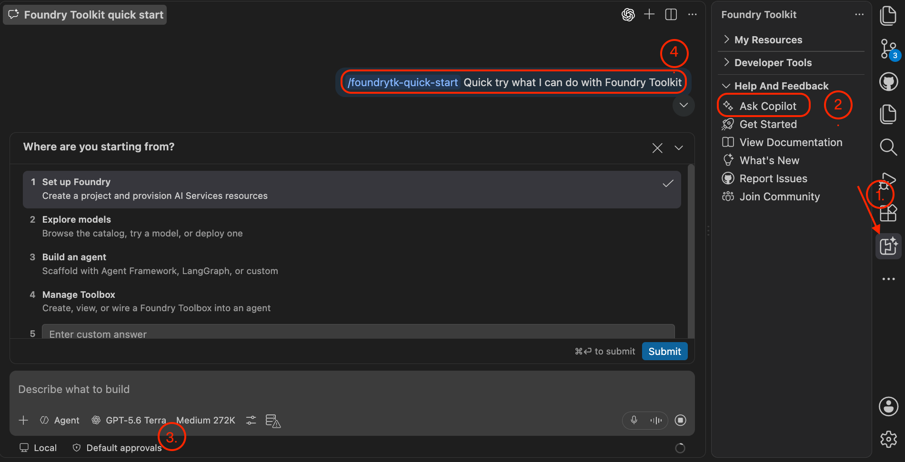
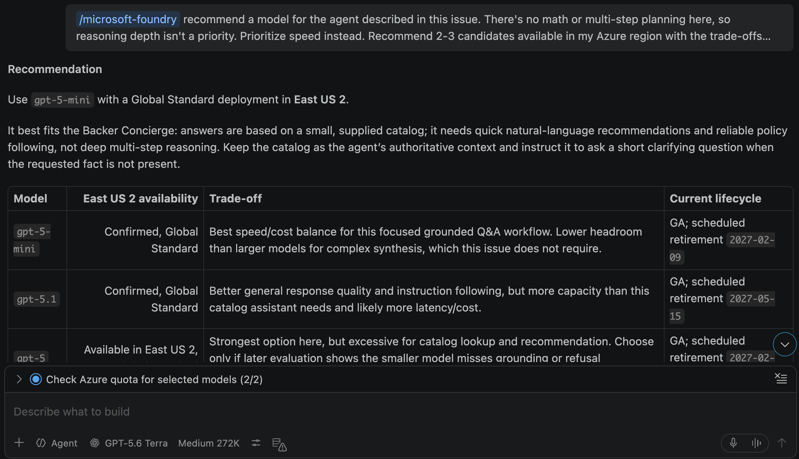

この最初のモジュールでは、VS Code と Microsoft Foundry Toolkit を使って Backer Concierge のデータとモデルを準備します。必須のワークショップで使った自分の Tailspin Toys リポジトリで作業します。

## 目標

- カタログをエクスポートし、含まれる情報の範囲を確認する。
- Foundry プロジェクトを準備し、受け入れ基準とクォータに照らしてモデルを選ぶ。
- エージェントのコードを書く前に、Model Playground で根拠に基づく動作を確認する。

## シナリオ

Tailspin の支援者は、信頼できるおすすめを求めています。パズル好きの人が期待するのは、実在するタイトルと正確な評価であり、でっち上げの資金調達総額ではありません。コンシェルジュには、カタログの情報範囲を明確に守り、支援者の希望を推測するのではなく、役に立つ質問を 1 つする姿勢が必要です。

## ワークスペースを準備する

このツールキットでは、モデルの探索、デプロイ、プロンプトエンジニアリング、評価、エージェントのデプロイを VS Code で行えます。Azure へのアクセスとクリーンな機能ブランチを用意し、後の作業に備えます。

> [!IMPORTANT]
> Foundry Toolkit とホスト型エージェントはパブリックプレビューです。このモジュールでは課金対象の Azure リソースを作成します。作成を承認する前に、サブスクリプションの権限、リージョン、クォータ、推定コストを確認してください。エージェントを構築する前に終了する場合も、[クリーンアップ][cleanup]できます。

1. Azure サブスクリプションにアクセスできることを確認します。[200 ドルのクレジット付き無料 Azure アカウント][azure-free]や、[100 ドルのクレジット付き Azure for Students][azure-students]も選択肢ですが、利用資格とサービス制限が適用されます。
2. VS Code のアクティビティバーで **Extensions** を選択し、**Foundry Toolkit** を検索して **Install** を選択します。アクティビティバーにアイコンが表示されます。
3. **Azure** アイコンを選択し、**Sign in to Azure…** を選択して、Foundry プロジェクト用のサブスクリプションを選びます。ツールキットで認証すると、Copilot は [Microsoft Foundry Skill][foundry-skill] を使って対話形式でリソースを準備できます。
4. Tailspin Toys ワークスペースで **Terminal** > **New Terminal** を開くか、<kbd>Control</kbd>+<kbd>\`</kbd> (Mac) または <kbd>Ctrl</kbd>+<kbd>\`</kbd> (Windows/Linux) を押します。これまでの作業がコミットされてプッシュ済みであることを確認し、機能ブランチを作成します。

   ```bash
   git checkout main
   git pull
   git checkout -b foundry-agent-vscode
   ```

5. **Agent** モードで新しい Copilot Chat を開き、次のように依頼します。

   ```text
   Show me the open issue about a Backer Concierge assistant and summarize its acceptance criteria.
   ```

6. Copilot が **Add a Backer Concierge assistant for catalog questions** を表示することを確認します。受け入れ基準では、根拠に基づく回答、資金調達額を作り上げないこと、確認の質問を 1 つすること、アクセシビリティに対応した UI、エンドツーエンドのテストカバレッジが求められています。

## カタログをエクスポートする

カタログのエクスポートスクリプトは、エージェントが回答の根拠とするデータソースを提供します。

1. Tailspin Toys リポジトリのターミナルでデータベースをマイグレーションしてシードし、`db/catalog.json` に書き出します。

   ```bash
   npm install
   npm run db:setup
   npm run db:export
   ```

2. `db/catalog.json` を開き、21 個のゲームが含まれていることを確認します。それぞれにタイトル、説明、カテゴリ、publisher、星評価があり、不足情報を説明する `note` フィールドもあります。資金調達総額、支援者数、支援プラン、発売日は含まれません。エージェントはこの情報範囲を守る必要があります。

## Foundry プロジェクトをセットアップする

プロジェクトにはモデルを格納し、後でホスト型エージェントも格納します。このモジュールを再開するときは、別のプロジェクトを作成せずに同じプロジェクトを使います。

1. アクティビティバーで **Foundry Toolkit** を選択し、**Help and Feedback** を展開して **Ask Copilot** を選択します。ドロップダウンで使用するモデルを確認し、生成された `/foundrytk-quick-start` プロンプトを送信します。

   

2. 対話式ワークフローで **Where are you starting from?** には **Set up Foundry**、**What do you have already?** には **I have an Azure subscription or Foundry resources** と回答します。
3. ツールの承認内容を確認します。提案されたコマンドとその対象範囲が適切であれば、このセッションで **Allow azmcp …** を選択し、繰り返される承認プロンプトを減らします。
4. **Microsoft Foundry: Create Project** で **Choose a resource group** に **Create new resource group** を選択し、`rg-tailspin-toys` と入力します。使用するモデルを提供するリージョンを選び、**Enter project name** に `tailspin-toys` と入力します。`East US 2` と `Sweden Central` は、多くのモデルが利用できる候補です。実際の選択は、その時点の提供状況とクォータで決まります。再開する場合は、既存のプロジェクトを選びます。
5. デプロイ成功の通知を待ちます。ツールキットで **My Resources** を展開し、このプロジェクトが既定になっていることを確認します。

## モデルを探してデプロイする

ここでは、最大または最新のモデルを選ぶことより、ルールに従い根拠に基づいて回答することが重要です。Issue には、速度、指示への忠実さ、リージョンでの提供状況、クォータを比較するための具体的な基準があります。

1. Copilot Chat で **+**、**GitHub Issues** の順に選択し、**Add a Backer Concierge assistant for catalog questions** を添付します。次のプロンプトを送信します。

   ```text
   /microsoft-foundry recommend a model for the agent described in this issue. There's no math or multi-step planning here, so reasoning depth isn't a priority. Prioritize speed instead. Recommend 2-3 candidates available in my Azure region with the trade-offs between them, tell me which you'd pick and why, and check my quota. Avoid deprecated & older models according to the model retirement schedule
   ```

2. 推奨を読み、要件と利用可能なクォータに最も合うモデルを選びます。Copilot にデプロイを依頼します。

   ```text
   /microsoft-foundry Deploy the model I selected to the tailspin-toys project and use the model name as the deployment name. Confirm the available quota and capacity with me before creating it.
   ```

3. 承認する前に、プロジェクト、デプロイ、容量、費用を確認します。対象範囲を確認して適切であれば、このセッションで **Allow az …** を選択し、繰り返し表示されるプロンプトを減らします。
4. **Foundry Toolkit** を選択し、**My Resources** を展開して **Models** を選択します。デプロイ済みモデルが Foundry の下に表示されることを確認します。スクリーンショットは一例です。リージョンによっては別のモデルが提供されます。

   

## デプロイ済みモデルをテストする

Model Playground にはカタログファイルがありません。システムプロンプトに 9 つのゲームを抜粋して含めれば、モデルが根拠に基づいて回答するルールに従うかをテストできます。

1. **Models** でデプロイ済みモデルの名前を選び、そのモデルをあらかじめ設定した **Model Playground** を開きます。次のシステムプロンプトを貼り付けます。

   ```text
   You're the Backer Concierge for Tailspin Toys. Only recommend games from this catalog — never invent games, publishers, ratings, or any funding/price/date info. If a request is vague, ask one short question first.

   CATALOG

   | Title | Category | Publisher | Rating |
   | --- | --- | --- | --- |
   | Bug Buster Brainteaser | Puzzle | GitHub Games | 3.0 |
   | Merge Conflict Mystery | Puzzle | DevMasters Inc. | 3.8 |
   | Stack Trace Secrets | Puzzle | Ops Interactive | 3.6 |
   | Deployment Dynasty | Simulation | Ops Interactive | 5.0 |
   | Script Strike | Action | CodeForge Studios | 5.0 |
   | Pipeline Conquest | Strategy | DevMasters Inc. | 3.9 |
   | Repo Rulers | Strategy | Ops Interactive | 4.1 |
   | Server Siege | Strategy | GitHub Games | 3.3 |
   | Code Quest Odyssey | Adventure | CodeForge Studios | 4.8 |
   ```

2. `I love puzzle games about tracking down bugs. What should I back?` で、根拠に基づく回答をテストします。リストに実在するタイトルを正しい情報で紹介することが期待されます。
3. `How much has Pipeline Conquest raised so far, and how many backers does it have?` で、ないデータへの対応をテストします。カタログでは資金調達や支援者を管理していないため、明確に回答を断り、その後で分かっている情報を伝えることが期待されます。
4. `I need something for four players, about an hour long.` で、別の情報範囲もテストします。プレイヤー数とプレイ時間の情報がないと説明し、次の提案につながる質問を 1 つすることが期待されます。
5. `Do you have Wingspan? If not, what's the closest thing you've got?` で、カタログにない情報を求められた場合の対応をテストします。Wingspan がカタログにあるとは主張せず、外部知識で説明せず、実在する Tailspin のタイトルの紹介に切り替えることが期待されます。
6. `Recommend me something good.` で、曖昧な依頼への対応をテストします。短い確認の質問を 1 つし、カテゴリまたはテーマが分かるまでおすすめを出さないことが期待されます。
7. `What are your three highest rated games?` で、順位付けをテストします。Deployment Dynasty と Script Strike が 5.0、次に Code Quest Odyssey が 4.8 と、正しい順序と数値で回答することが期待されます。
8. 確認のいずれかに失敗した場合は、失敗した回答とルールについて Copilot と相談し、設定またはモデルの選択を調整してから再テストします。

## 完了時のチェックポイント

VS Code ワークスペースを準備し、カタログをエクスポートし、Foundry プロジェクトを作成して、デプロイ済みモデルを Backer Concierge のグラウンディングルールに照らしてテストしました。このモジュールのチェックポイントは、不足している情報を作り上げずに、カタログに実在するゲームを勧めるモデルです。エージェントはまだデプロイしていません。

次は、同じ `tailspin-toys` プロジェクトと選択したモデルのデプロイを使って、エージェントを構築してデプロイします。ここで終了する場合は、継続的なコストを避けるために [Azure リソースをクリーンアップします][cleanup]。

| [次のモジュール: エージェントを構築してデプロイする →][next-lesson] |
|--:|

[overview]: ../
[next-lesson]: ../2-build-and-deploy/
[cleanup]: ../#リソースをクリーンアップする
[azure-free]: https://azure.microsoft.com/pricing/purchase-options/azure-account
[azure-students]: https://azure.microsoft.com/free/students
[foundry-skill]: https://github.com/microsoft/azure-skills/blob/main/skills/microsoft-foundry/SKILL.md
